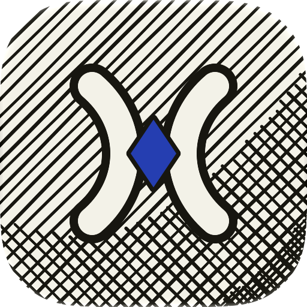

# Logn

A native macOS app that compresses any file. It's fast, it has no window, and it lives in the menu bar.

- **Drag any file** and a capsule slides in at the top of the screen. Drop on **Smart** for the smallest file that looks identical, or on **Lossless** for identical content. Hold ⌥ to swap the halves.
- **⌃⌥Space** opens a Liquid Glass tray across the bottom ~25% of the screen. It shows the live queue, history, and settings.
- **Originals are never overwritten.** Output is never larger than the input; when nothing can be saved, Logn reports "Already optimal". Every lossless result is verified before it's written. *Replace Original* moves the original to the Trash and can be undone with ⌘Z.

| Input | Lossless | Smart |
|---|---|---|
| PNG | own optimiser + libdeflate (−26…35%) | Oklab palette quantiser (≈ −77% on UI) |
| JPEG | Huffman-optimised (pixel-identical) or progressive (DCT-exact) | SSIM-targeted re-encode + progressive (≈ −24%) |
| HEIC | — | SSIM-targeted HEIC (≈ −23%) |
| PDF | — | Quartz filter image downsampling (≈ −93%) |
| Video | — | VideoToolbox HEVC (≈ −56%, hardware) |
| WAV / AIFF | FLAC (−50%) | AAC (−87%) |
| Anything else / folders | `.xz` / `.tar.xz` (or `.zip`) | same |

The percentages are measured on the sample set in `docs/research/codecs.md`. Opt-in conversion to HEIC/AVIF is available for images.

## Install

macOS 26 or later, Apple silicon. Both are available from the first release.

```sh
brew install --cask stringsaeed/tap/logn
```

Or download `Logn-<version>.dmg` from [GitHub Releases](https://github.com/Stringsaeed/o-log-n/releases).

## Build & run
Requires macOS 26+ and Xcode 27 (Swift 6.4).
```sh
swift build -c release                 # engine, CLI, app
swift test                             # engine tests (Swift Testing)
scripts/bundle.sh                      # → build/Logn.app (ad-hoc signed)
open build/Logn.app
```

The app icon is an Icon Composer document, `Support/AppIcon.icon`: a pen-and-ink drawing written out by `scripts/make-icon.py`, with its own dark, tinted and clear appearances. `scripts/bundle.sh` compiles it into the app with `actool`. After changing it, run `scripts/make-icon-previews.sh` to refresh the fallback `.icns` and the image above.

The CLI runs the same engine:
```sh
.build/release/ologn-cli compress ~/Desktop/shot.png --mode lossless
.build/release/ologn-cli verify original.png original-min.png   # exit 0 = content-identical
```

The app has built-in checks: `--selftest`, `--selftest-replace`, `--selftest-keys`, `--selftest-history`, and `--bench-tray`. `--demo --demo-open tray|settings|dropzone-smart|…` renders every UI state for screenshots without touching real files or settings.

## Release
Merging the `chore: release x.y.z` pull request tags `vX.Y.Z`. CI signs, notarizes, publishes the DMG, and bumps the Homebrew cask. One-time setup, and the local `scripts/release.sh <version>` path, are in [docs/release.md](docs/release.md).

## Layout
| Path | What |
|---|---|
| `Sources/OLogNKit` | Engine: routing, codecs, verification, job scheduling (no UI) |
| `Sources/OLogNApp` | Menu-bar app: dropzone, tray, settings, history |
| `Sources/ologn-cli` | Headless CLI over the engine |
| `Vendor/` | libdeflate 1.26 (MIT) and libjpeg-turbo 3.2.1 (BSD/IJG), with SIMD off |
| `docs/architecture.md` | Binding architecture and decisions (§10 = product decisions) |
| `docs/design/ux.md` | UX, interaction, and motion spec |
| `docs/review/` | Review findings and fix notes for each slice |
